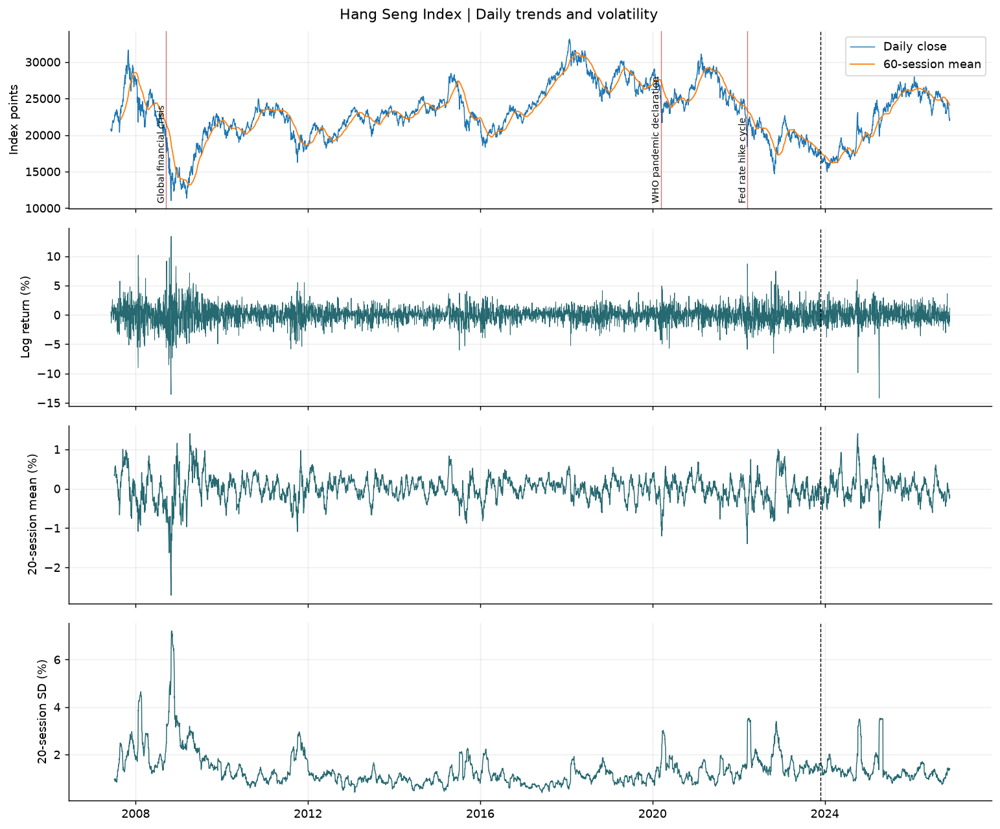

# 恒生指数数据采集、预处理与探索性分析

## 数据采集与质量

本文使用腾讯财经恒生指数（`hkHSI`）日线。程序按年请求 2005 年至 2026-11-26 的行情，共取得 5,398 条原始记录。请求地址、逐年行数以及原始响应 SHA-256 摘要已记录。采集入口与指数介绍见 [仓库首页](../README.md)。

源端提供指数开盘、最高、最低、收盘及第六数值字段。该接口未返回独立的调整收盘价，也未提供可核验的第六字段单位。研究使用恒生**价格指数收盘点位**，该口径不包含股息再投资。第六字段以 `provider_activity` 保留，未纳入共享特征。研究未合并美元指数或美国十年期国债收益率等可选因子。

记录按香港交易日排序。全样本无完全重复记录。对照 XHKG 交易日历，2020-10-13 和 2023-07-17 属于非交易日，而接口在这两天将前一日收盘重复填入全部价格栏，并记录零活动值，因此删除。清洗后取最后 4,800 个交易日，区间为 2007-06-04 至 2026-11-26，区间内无缺失交易日。周末和休市日不前填。两条记录存在 OHLC 区间矛盾，具体见 [OHLC 审计表](ohlc_audit.csv)。对应开、高、低留空，正值收盘按来源保留，未作独立校验。这是数据源的局限。

相邻交易日的收益率按 $r_t=\ln(P_t)-\ln(P_{t-1})$ 计算。训练集的中位数和 MAD 用来设定极端收益率的识别阈值，4,799 个收益率中有 18 个超过阈值。极端值保留并单列，以保留真实行情冲击的可能性。[清洗记录](audit.json) · [日历审计](calendar_audit.csv) · [极端值明细](extreme_returns.csv)

## 收益率分布与波动

训练集的日收益率均值为 −0.00409%，方差为 0.00024075（小数收益率的平方），偏度为 0.08619，超额峰度为 7.32802。Jarque–Bera 统计量为 9,065.48，正态性假设被显著拒绝。偏度接近零，而超额峰度明显为正，直方图与正态 Q–Q 图也显示尾部偏离。全样本超额峰度为 8.20634。表中的极小 p 值可能因浮点下溢显示为 0。[描述统计](descriptive_stats.csv)

20 日滚动标准差显示波动在相邻交易日内集中。2008 年金融危机期间的波动尤为明显。图中的雷曼破产、世卫组织宣布新冠疫情构成全球大流行、美联储首次加息分别用于定位事件发生期，事件标注不构成因果检验。

## 训练集平稳性、白噪声与季节性

| 检验 | 统计量 | p 值 | 5% 水平结论 |
| --- | ---: | ---: | --- |
| 对数收盘价 ADF（19 阶滞后） | −2.644 | 0.08432 | 无法拒绝单位根 |
| 对数收益率 ADF（18 阶滞后） | −14.078 | < 0.001 | 拒绝单位根 |
| 收益率 Ljung–Box（5 阶） | 6.313 | 0.27697 | 无法拒绝截至 5 阶的联合无自相关假设 |
| 收益率 Ljung–Box（10 阶） | 24.531 | 0.00631 | 拒绝截至 10 阶的联合无自相关假设 |
| 收益率 Ljung–Box（20 阶） | 44.747 | 0.00119 | 拒绝截至 20 阶的联合无自相关假设 |
| 平方收益率 Ljung–Box（20 阶） | 4,020.645 | < 0.001 | 存在显著的平方收益率自相关 |
| 去均值收益率 ARCH-LM（10 阶） | 997.280 | 7.21 × 10⁻²⁰⁸ | 拒绝无 ARCH 效应 |
| 月度收益率按月份分组 Kruskal–Wallis | 14.398 | 0.21175 | 未发现显著月份分组差异 |
| 月度收益率 Ljung–Box（12 阶） | 5.930 | 0.91959 | 未发现截至 12 阶的显著联合自相关 |

ADF 含常数项，按 AIC 选择检验滞后。月度季节性诊断使用训练收益率按月求和，并排除首尾两个月作为边界。年度柱图为各年样本内对数收益率之和，2007 年和 2026 年为部分年度。完整结果见 [训练集检验](train_tests.csv)。

因此，本组数据符合**情况 1**。均值建模可将已经平稳化的收益率交给 B，ARIMA 的差分阶数从 0 考察。收益率部分滞后有统计显著性，样本外预测价值需与简单基线比较。现有季节性诊断暂不支持优先使用 SARIMA。平方收益率自相关与 ARCH-LM 结果支持另行以 GARCH 族描述条件波动。

## 共享特征和数据切分

预测时点为交易日收盘，任务为预测下一交易日收益率。共享输入由当日收益率、前 1／2／3／5／10 日的滞后收益率及过去 5／20／60 日的滚动均值与波动率组成。特征由起点当天及更早的数据计算。测试集按目标日切分，覆盖 2023-11-27 至 2026-11-26，共 738 日。训练集特征可用目标日共 4,001 日。按目标日期对齐 B 和 C 的回归结果及 D 的综合汇总。[交接说明](../HANDOFF.md) · [切分表](../data/split_summary.csv)
