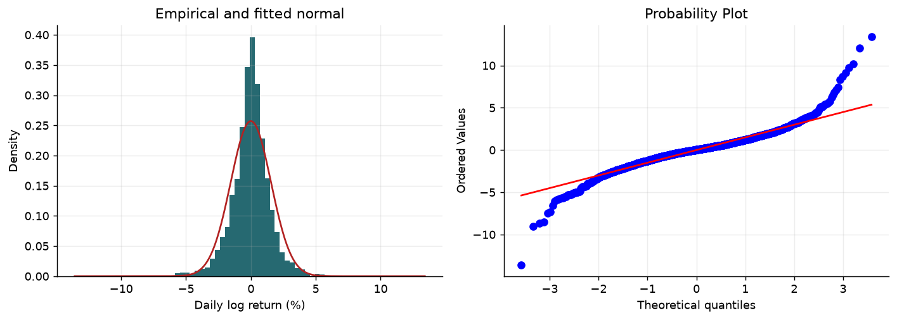
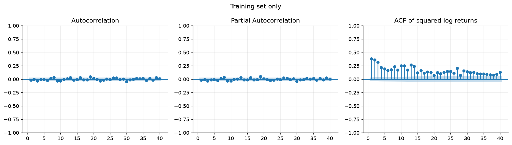
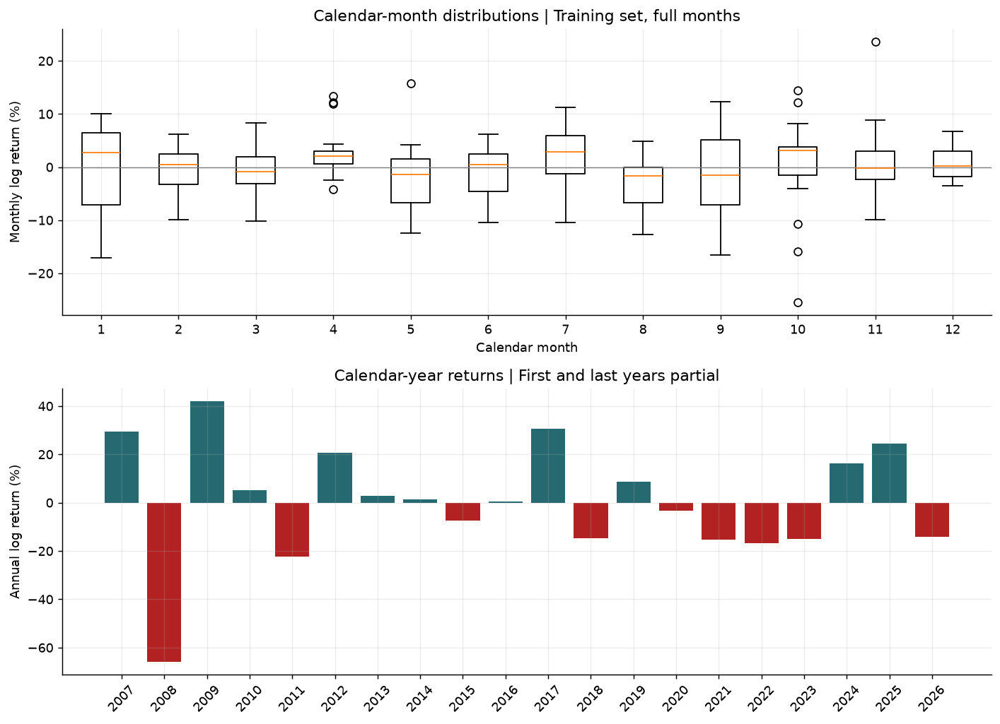

# 恒生指数数据采集、预处理与探索性分析

## 数据采集与质量

本文使用腾讯财经恒生指数（`hkHSI`）日线。程序按年请求 2005 年至 2026-11-26 的行情，共取得 5,398 条原始记录。请求地址、逐年行数以及原始响应 SHA-256 摘要已记录。采集入口与指数介绍见 [仓库首页](../README.md)。

源端提供指数开盘、最高、最低、收盘及第六数值字段。该接口未返回独立的调整收盘价。研究使用恒生**价格指数收盘点位**，该口径不包含股息再投资。第六字段以 `provider_activity` 保留，未纳入共享特征。研究未合并美元指数或美国十年期国债收益率等可选因子。

抽查表明，第六字段对应港股主板成交额，以港元计。2026-01-02 的原值 140,863,936,026 港元约为 1,408.64 亿港元，2026-01-05 的原值 283,462,308,937 港元约为 2,834.62 亿港元，均与当日主板成交额报道吻合。这是同日数值交叉验证，腾讯返回的日线 JSON 未附字段字典。项目另用港交所统计档案和逐日日报补齐 4,800 日的主板成交股数及成交额。这是主板市场口径，样本不掺入不同口径的成交量。含股息再投资的分析可使用恒生指数公司发布的总回报指数序列。[1 月 2 日新华财经](https://www.cnfin.com/gs-lb/detail/20260102/4359581_1.html) · [1 月 5 日新华社报道](https://www.hkcd.com.hk/hkcdweb/content/2026/01/05/content_8734156.html) · [恒生总回报指数](https://www.hsi.com.hk/index-resources/total-return-index-series/)

全段收益率统一由腾讯收盘价计算。港交所主板成交量、成交额另提供收盘时点对齐的可选特征表。[港交所统计档案](https://www.hkex.com.hk/Market-Data/Statistics/Consolidated-Reports/Securities-Statistics-Archive/Trading_Value_Volume_And_Number_Of_Deals?sc_lang=en) · [港交所日报](https://www.hkex.com.hk/eng/stat/smstat/dayquot/d261126e.htm)

记录按香港交易日排序。全样本无完全重复记录。对照 XHKG 交易日历，2020-10-13 和 2023-07-17 属于非交易日，而接口在这两天将前一日收盘重复填入全部价格栏，并记录零活动值，因此删除。清洗后取最后 4,800 个交易日，区间为 2007-06-04 至 2026-11-26，区间内无缺失交易日。周末和休市日不前填。两条记录存在 OHLC 区间矛盾，具体见 [OHLC 审计表](ohlc_audit.csv)。保留腾讯收盘，将这两天的开、高、低留空，并保留源异常标记。

相邻交易日的收益率按 $r_t=\ln(P_t)-\ln(P_{t-1})$ 计算。训练集的中位数和 MAD 用来设定极端收益率的识别阈值，4,799 个收益率中有 18 个超过阈值。极端值保留并单列，以保留真实行情冲击的可能性。[清洗记录](audit.json) · [日历审计](calendar_audit.csv) · [极端值明细](extreme_returns.csv)

## 收益率分布与波动

训练集的日收益率均值为 −0.00409%，方差为 0.00024075（小数收益率的平方），偏度为 0.08619，超额峰度为 7.32802。Jarque–Bera 统计量为 9,065.48，正态性假设被显著拒绝。偏度接近零，而超额峰度明显为正，直方图与正态 Q–Q 图也显示尾部偏离。全样本超额峰度为 8.20634。表中的极小 p 值可能因浮点下溢显示为 0。[描述统计](descriptive_stats.csv)

20 日滚动标准差显示波动在相邻交易日内集中，2008 年金融危机期间尤为明显。事件标注从数据出发，以训练集收益率中位数为基准，筛选偏离超过 6 个稳健标准差的交易日，再按日期查询腾讯 `hkHSI` 新闻，并核对可取得的港交所资料。18 个异常日中有 15 日早于腾讯栏目可查起点 2022-08-23。在可查的 3 日中，2022-11-11 的新闻确认了恒指上涨，但本次未核实到相应的恒指政策或其他独立事件，因此只留在异常表和候选表。[异常日](extreme_returns.csv) · [腾讯查询覆盖](news_coverage.csv) · [候选报道及腾讯原址](news_candidates.csv)

- **2008-10-27**：恒指收于 11,015.84 点，下跌 1,602.54 点。港交所当天因媒体查询发布恒指异常跌幅的专项市场统计，记录的简单收益率约 −12.7%。[港交所当日公告](https://www.hkex.com.hk/News/Regulatory-Announcements/2008/081027news?sc_lang=en)
- **2024-10-08**：恒指简单收益率约 −9.41%。腾讯报道记录恒指大跌和市场成交创新高，港交所统计记载当日市场成交额约 6,207 亿港元。图上标的是当日市场事件。[腾讯报道](https://gu.qq.com/resources/shy/news/detail-v2/index.html#/index?id=nesSN2024100818541795982525&s=b)
- **2025-04-07**：恒指简单收益率约 −13.22%，跌破 20,000 点。腾讯报道记录香港财政司司长对市场波动的回应，港交所统计记载当日市场成交额约 6,210 亿港元。图上标的是当日下跌与回应。[腾讯报道](https://gu.qq.com/resources/shy/news/detail-v2/index.html#/index?id=nesSN202504072200199730cc59&s=b)

港交所成交额是市场背景。三条标注均为与恒指异常同日的可核实记录，未据此推断下跌原因。疫情期间可从完整走势观察，本次筛选与核对没有产生疫情事件标注。[港交所年度市场统计](https://www.hkex.com.hk/-/media/HKEX-Market/Market-Data/Statistics/Consolidated-Reports/Annual-Market-Statistics/2025FY-Annual-Market-Stat_Eng.pdf) · [标注清单](events.csv)

## 训练集平稳性、白噪声与季节性

| 检验 | 统计量 | p 值 | 5% 水平结论 |
| --- | ---: | ---: | --- |
| 原始收盘点位 ADF（0 阶滞后） | −2.652 | 0.08265 | 无法拒绝单位根 |
| 对数收盘价 ADF（19 阶滞后） | −2.644 | 0.08432 | 无法拒绝单位根 |
| 对数收益率 ADF（18 阶滞后） | −14.078 | < 0.001 | 拒绝单位根 |
| 收益率 Ljung–Box（5 阶） | 6.313 | 0.27697 | 无法拒绝截至 5 阶的联合无自相关假设 |
| 收益率 Ljung–Box（10 阶） | 24.531 | 0.00631 | 拒绝截至 10 阶的联合无自相关假设 |
| 收益率 Ljung–Box（20 阶） | 44.747 | 0.00119 | 拒绝截至 20 阶的联合无自相关假设 |
| 平方收益率 Ljung–Box（20 阶） | 4,020.645 | < 0.001 | 存在显著的平方收益率自相关 |
| 去均值收益率 ARCH-LM（10 阶） | 997.280 | 7.21 × 10⁻²⁰⁸ | 拒绝无 ARCH 效应 |
| 月度收益率按月份分组 Kruskal–Wallis | 14.398 | 0.21175 | 未发现显著月份分组差异 |
| 月度收益率 Ljung–Box（12 阶） | 5.930 | 0.91959 | 未发现截至 12 阶的显著联合自相关 |

ADF 含常数项，按 AIC 选择检验滞后。月度季节性诊断使用训练收益率按月求和，并排除首尾两个月作为边界。年度柱图为各年样本内对数收益率之和，2007 年和 2026 年为部分年度。完整结果见 [训练集检验](train_tests.csv)。

训练收益率的 ACF 和 PACF 在多数滞后阶接近零，前 1、2 阶均在逐点 95% 区间内，第 3、8、9、10、19、30 阶分别出现孤立的显著值。图中没有清晰的低阶拖尾与截尾组合，逐点区间也未作多重比较校正，不能凭图唯一确定 AR 或 MA 阶数。滚动标准差与平方收益率自相关提示明显的波动聚集，拟合后的条件异方差需要用 B 的模型残差核实。[逐阶系数和区间](train_correlations.csv)

因此，本组数据符合**情况 1**。均值建模可将已经平稳化的收益率交给 B，ARIMA 的差分阶数从 0 考察。收益率部分滞后有统计显著性，样本外预测价值需与简单基线比较。现有季节性诊断暂不支持优先使用 SARIMA。平方收益率自相关与 ARCH-LM 结果支持另行以 GARCH 族描述条件波动。

### 异常节点的证据类型

2008-10-27 是港交所发布的市场统计，2024-10-08 是恒指行情及市场成交纪录，2025-04-07 是恒指行情和财政司司长回应。现有核对未证实三日各自有针对恒指的新政策或指数调整出台。这些标注用于回查异常交易日及当时市场背景。

## 共享特征和数据切分

预测时点为交易日收盘，任务为预测下一交易日收益率。共享输入由当日收益率、前 1／2／3／5／10 日的滞后收益率及过去 5／20／60 日的滚动均值与波动率组成。特征由起点当天及更早的数据计算。测试集按目标日切分，覆盖 2023-11-27 至 2026-11-26，共 738 日。训练集特征可用目标日共 4,001 日。按目标日期对齐 B 和 C 的回归结果及 D 的综合汇总。[交接说明](../HANDOFF.md) · [切分表](../data/split_summary.csv)
